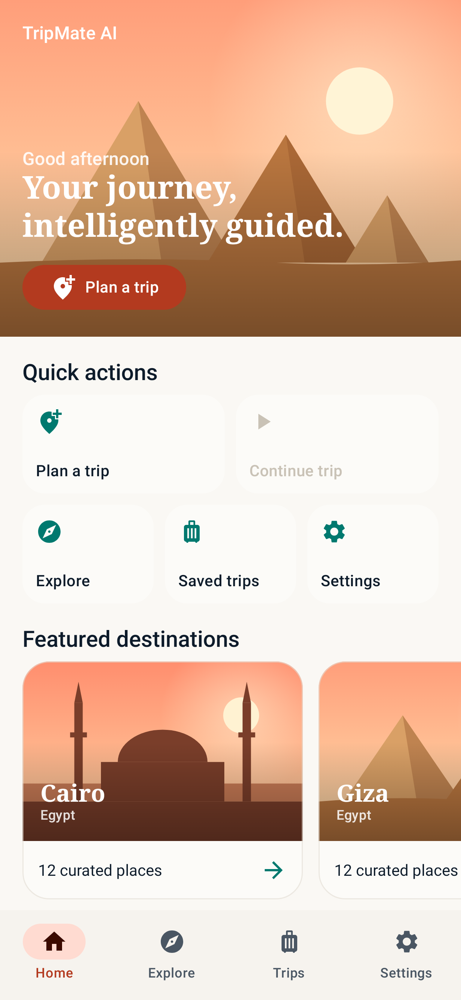
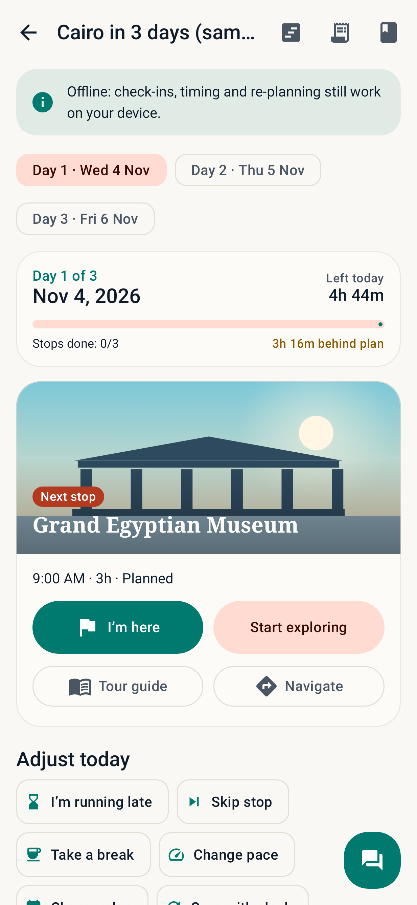
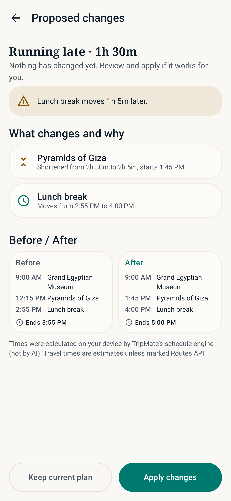
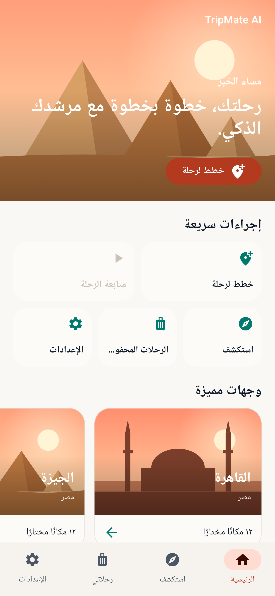

# TripMate AI 🧭

> **Your journey, intelligently guided.** · **رحلتك، خطوة بخطوة مع مرشدك الذكي.**

TripMate AI is a native Android travel planner **and** live companion for travellers in Egypt and beyond.
It plans a trip, goes with you stop by stop, reacts when you're running late, and proposes clear,
**user-approved** before/after changes. Arabic (RTL) and English are both fully supported.

| Home (EN) | Active trip | Before / After | Home (AR, RTL) |
|---|---|---|---|
|  |  |  |  |

*The screenshots are produced automatically by the Robolectric UI smoke tests in demo mode (no API keys).*

---

## Features

- **Onboarding:** three animated slides, Arabic/English picker, interests, pace, walking level and daily budget. Guest mode by default.
- **Home:** greeting hero, the active trip's next step, quick actions and featured destinations.
- **Trip wizard (6 steps):** destination (Cairo, Giza, Alexandria seeded, or any city), dates and hours per day, budget and currency, interests and pace, group size and transport, walking and food preferences, plus optional Gemini.
- **Itinerary:** day tabs, map preview, timeline, and stop editing (edit, reorder, delete, add from the catalog or as a custom stop). Every stop shows its **verification badge**.
- **Active Trip Mode (hero feature):**
  - day progress, time left, and drift ("25 min behind plan");
  - **I'm here** (GPS is only a hint and the user always confirms), **Start exploring**, **Finished**, **I'm running late** (20/45/90), **Skip stop**, **Take a break**, **Change pace**, **Change plan** (natural language), and **Sync with clock**;
  - **Navigate** opens any installed maps app, and a scoped AI chat sheet is available.
- **Before/After proposal screen:** the reason for each change, warnings (day overrun, may close before you finish), and **Apply** / **Keep plan**. Nothing is saved until the user taps Apply.
- **AI tour guide:** short, detailed or kid-friendly modes; "What should I look for?"; quick questions (history, architecture, customs, tips); free questions; on-device summarise; and photo explanation with explicit consent. Facts are separated from AI text.
- **Explore:** curated places, live Google Places search (when configured), bookmarks, add to trip, and open in maps.
- **Budget:** expenses, categories, daily limit, remaining budget, and planned estimates. Amounts are **never converted** between currencies.
- **Journal:** notes and photos stored privately on the device, plus a **shareable trip summary** with no times, coordinates or notes by default.
- **Settings:** language, theme, currency, accessibility, reduced motion, opt-in notifications, cloud-AI consent, privacy notice, JSON export, delete all, optional Google sign-in with Firestore backup, licenses, and the **AI diagnostics panel**.

## Hybrid AI (Firebase AI Logic)

Implemented in `ai/AiInferenceCoordinator.kt`. It uses the real `firebase-ai` and `firebase-ai-ondevice` APIs, which I checked against the published AARs.

| Task | Inference mode |
|---|---|
| Summarise a guide passage, paraphrase a note, prep checklist | `PREFER_ON_DEVICE` |
| Guide narrative, questions, trip chat | `PREFER_IN_CLOUD` (on-device fallback) |
| Itinerary JSON, plan-change intent JSON, photo | `ONLY_IN_CLOUD` |
| Diagnostics self-test | `ONLY_ON_DEVICE` |

- **Model availability:** checked with `FirebaseAIOnDevice.checkStatus()`. The model download is user-initiated from the Diagnostics screen.
- **Provenance:** comes from the SDK's `response.inferenceSource`. The badge shows **On-device AI**, **Gemini Cloud**, **Saved offline content**, **Demo** or **AI unavailable**, and only for the path that actually ran.
- **Offline without a local model:** calls fail fast and fall back to cached AI text or curated bilingual content.
- **AI never controls the clock:** timing and re-planning are deterministic (`domain/logic/ScheduleEngine.kt`). AI only interprets complex requests, as validated JSON mapped onto engine actions. AI itineraries are rebuilt on top of the deterministic plan: unknown places become *Not verified*, durations are clamped, and the result is validated.
- **Privacy:** prompts contain only destination and place names, the user's question and schedule titles. Cloud use requires consent, and photos need a confirmation every time. Prompts and locations are never logged.

## Architecture

- **Language and UI:** Kotlin, Jetpack Compose, Material 3 with custom tokens (separate light and dark schemes).
- **Structure:** MVVM with UI / domain / data layers, Hilt, coroutines and StateFlow, and type-safe Navigation Compose.
- **Storage:** Room is the offline source of truth; DataStore holds preferences.
- **Network:** OkHttp for Places API (New) and Routes API.
- **Optional integrations:** Firebase AI Logic, Auth and Firestore.

```
app/src/main/java/com/tripmate/ai/
├── ai/              AiInferenceCoordinator, GuideService, AiPrompts, NetworkMonitor
├── data/            db (Room), mapper, repo, prefs (DataStore), remote (Places/Routes), account, seed (curated catalog)
├── domain/          model, logic (ScheduleEngine, ItineraryGenerator, ItineraryValidator, BudgetCalculator, Geo), ai (AiJson)
├── di/              Hilt module
├── ui/              theme, components (DestinationArt, MapPreview, badges…), navigation, screens/*
└── util/            formatters, location, notifications, image store, exporter, locale
app/src/debug|release/…/AppCheckInstaller.kt   (debug provider vs Play Integrity)
app/src/test/…       unit tests + Robolectric UI smoke tests (EN + AR/RTL)
codemagic.yaml       CI: tests → lint → debug APK (no secrets needed)
```

## Build and run

- **Requirements:** JDK 17+ and the Android SDK (compileSdk/targetSdk **36**, minSdk **26**, which `firebase-ai-ondevice` requires).
- **Toolchain:** AGP 8.13.2, Kotlin 2.3.21, Gradle 8.14.3 (wrapper committed).

```bash
cp local.properties.example local.properties   # set sdk.dir; keys optional
./gradlew testDebugUnitTest    # 36 tests incl. EN + Arabic UI journeys
./gradlew lintDebug
./gradlew assembleDebug        # → app/build/outputs/apk/debug/app-debug.apk
```

**Demo mode:** with no `google-services.json` and no Maps key, the app compiles and runs fully offline. It uses the curated catalog, the deterministic planner, saved guide content and a schematic (clearly labelled, not-a-map) preview.

## Codemagic: get an APK without Android Studio

1. Sign in at [codemagic.io](https://codemagic.io), **Add application**, choose GitHub and this repository, and select **codemagic.yaml** as the configuration.
2. Start the **TripMate AI · Debug APK** workflow on your branch. No secrets are required.
3. When it finishes, download **`app-debug.apk`** from the build's **Artifacts** (`app/build/outputs/apk/debug/`).
4. Install it on your phone. You may need to allow *Install unknown apps*.

**Optional secrets** (Environment variables, group `tripmate_optional`):

| Variable | Contents |
|---|---|
| `GOOGLE_SERVICES_JSON` | `base64 -w0 app/google-services.json` |
| `MAPS_API_KEY` | Android-restricted Maps Platform key |
| `GEMINI_CLOUD_MODEL` | Optional override of the cloud model name |

**Signed release:** upload a keystore under *Code signing identities* with the reference name `tripmate_keystore`, then push a tag such as `v1.0.0` to run `android-release` (APK + AAB).

## Firebase setup (optional)

1. Create a Firebase project. In the Android app, use the package `com.tripmate.ai`; debug builds use `com.tripmate.ai.debug`, so register both.
2. Go to **AI Services → AI Logic → Get started** and choose the *Gemini Developer API*. App Check is enforced.
3. For debug builds, run the app, copy the App Check **debug token** from Logcat, and add it under *App Check → Manage debug tokens*. Release builds use Play Integrity.
4. *Optional:* enable **Authentication → Google** and **Firestore** for sign-in and backup. Firestore rules should allow only `users/{uid}/**` for that `uid`.
5. Put `google-services.json` in `app/` locally (git-ignored), or base64-encode it into `GOOGLE_SERVICES_JSON` on Codemagic.

**On-device AI** runs only on devices supported by the ML Kit Prompt API / AICore (recent flagship phones). On every other device the app shows **"Not supported on this device"** and falls back to the cloud or saved content. It never claims local inference that didn't happen.

## Maps setup (optional)

Enable **Maps SDK for Android**, **Places API (New)** and **Routes API**. Restrict the key to Android apps (package + SHA-1); the REST calls send `X-Android-Package` and `X-Android-Cert`. Set it as `tripmate.mapsApiKey` in `local.properties` or `MAPS_API_KEY` in CI.

**What a client app can't keep secret:** any key shipped in an APK can be extracted. Protect keys with Android-app restrictions, API restrictions, quotas, and Firebase App Check. Never put service-account JSON or unrestricted keys in the app.

## Honesty and verification

- **Sample data:** sample prices and opening hours are labelled *illustrative* and *unverified*. Travel times are *offline estimates* unless they come from the Routes API.
- **Places results:** Places search results are *Verified* for name and location only. Hours and prices are never fetched or claimed.
- **Bookings:** there are no live bookings or payments, and no exchange rates are integrated.
- **Offline map:** no offline map tiles are bundled. The offline preview is a labelled schematic.

## Verification status (at time of delivery)

| Check | Result |
|---|---|
| `./gradlew testDebugUnitTest` | ✅ 36/36 passed. Covers schedule engine, validator, budget, Room mapping and AI-JSON parsing, plus 2 Robolectric UI journeys (EN; AR/RTL). |
| `./gradlew lintDebug` | ✅ 0 errors (warnings only) |
| `./gradlew assembleDebug` | ✅ `app-debug.apk` built |
| Physical device or emulator | ⚠️ Not run: the build machine had no KVM. Runtime was checked with Robolectric (Android 15 runtime) in demo mode. |
| Live Gemini cloud, on-device inference, Places, Routes, Google sign-in, Firestore | ⚠️ Implemented but **not exercised**: no credentials or supported device were available. These paths sit behind clear configuration and fallback boundaries. |

## Troubleshooting

- **"AI unavailable" or "Demo" everywhere:** there's no `google-services.json`, or AI Logic and App Check aren't set up (register the debug token).
- **On-device shows "Not supported":** expected on most devices. Use the cloud, or saved content.
- **Blank Google map:** the Maps key is missing or restricted. Without a key, the schematic preview is used instead.
- **Robolectric can't download `android-all` in CI:** set `ROBOLECTRIC_REPO_URL` to a Maven mirror.

## License and attributions

Destination illustrations are original vector drawings created for this project. Curated place texts are original summaries, and coordinates are approximate public landmark locations. Third-party libraries are listed in-app under **Settings → Licenses**.
