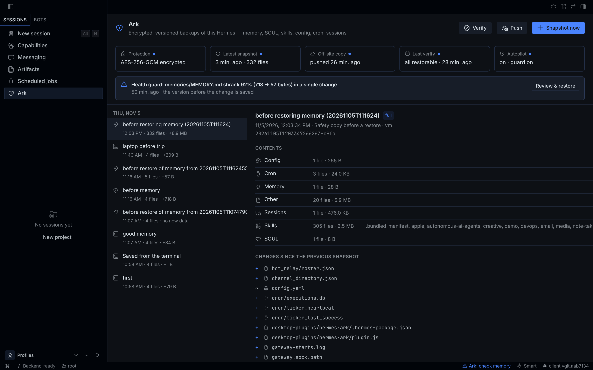
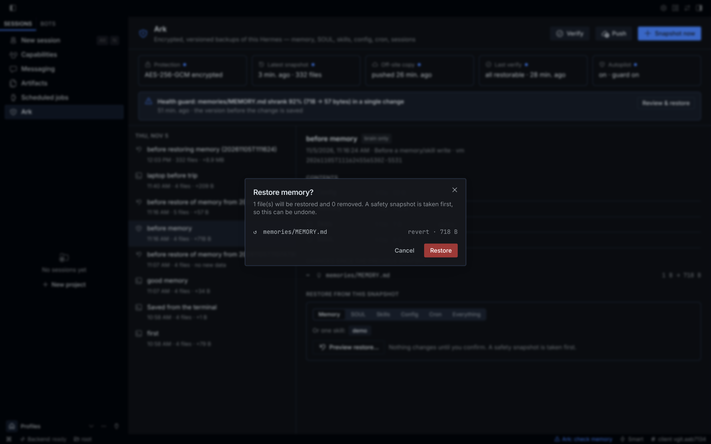
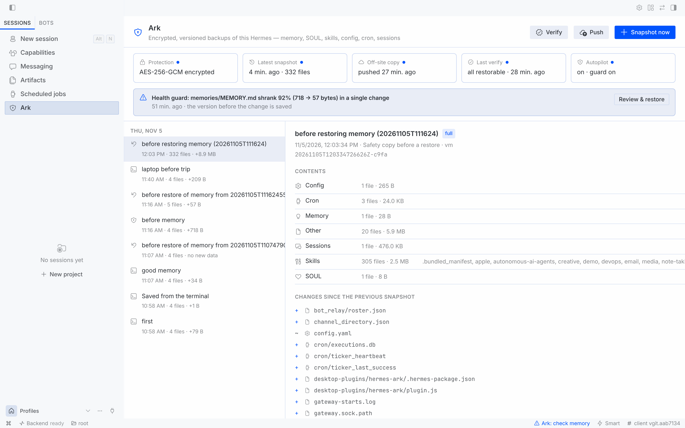

# Hermes Ark 🛡

**Encrypted, versioned backups of your whole Hermes — automatic, off-site, and restorable one piece at a time.**



Hermes learns for months: its memory, `SOUL.md`, skills it wrote itself, cron jobs, sessions, every profile.
One over-eager *"clean up your memory"*, a bad update, a dead disk or a reclaimed VPS — and it is gone.

| | `hermes backup` (built in) | memory-rewind | **Hermes Ark** |
|---|---|---|---|
| Automatic | ✗ manual | ✓ memory & skills | ✓ everything, before every memory/skill write |
| Catches a wipe as it happens | ✗ | ✗ | ✓ health guard tells the agent *and* you |
| Encrypted | ✗ (API keys in a plain zip) | ✗ | ✓ AES-256-GCM, credentials excluded by default |
| Off-site (S3 / R2 / B2 / folder) | ✗ | ✗ | ✓ push, pull, new-machine recovery |
| Deduplicated | ✗ full zip each time | ✓ git | ✓ content-addressed, chunked |
| Restore one item | ✗ all or nothing | ✓ memory & skills | ✓ memory · SOUL · one skill · config · cron · a file · a profile |
| Proves backups restore | ✗ | ✗ | ✓ `verify` |
| Desktop UI | ✗ | ✗ | ✓ timeline, diffs, one-click restore |

## Install

```bash
hermes plugins install hermes-ark && hermes plugins enable hermes-ark
echo 'ARK_PASSPHRASE=choose-a-long-passphrase' >> ~/.hermes/.env   # keep a copy somewhere safe
hermes ark init        # creates the encrypted repository
hermes ark snap first  # first snapshot; from now on Ark runs on its own
```

In Hermes Desktop, enable **Hermes Ark** under *Capabilities → Plugins* to get the **Ark** page.

## What happens automatically

- **Checkpoint before every memory/skill write.** Ark wraps Hermes' `memory` and `skill_manage` tools and saves a
  *brain* snapshot (memory, SOUL, skills, config, cron) right before the change — nothing is stored when nothing changed.
- **Health guard.** When memory shrinks by more than half or several skills vanish in one call, the warning goes
  **into the tool result**, so the agent sees it at once and tells you — with the exact undo command:

  ```
  ⚠ Hermes Ark health guard:
    - memories/MEMORY.md shrank 92% (718 → 57 bytes) in a single change
    The previous version is saved in snapshot 20261105T111624556530Z-5531.
    To undo, the user can run: /ark restore memory 20261105T111624556530Z-5531 yes
  ```
  Desktop shows the same alert on the Ark page and turns the status-bar shield into **⚠ Ark: check memory**.
- **Full snapshots** in the background after sessions (every `interval_minutes`, default 60), **pushed off-site**
  when a remote is set, and **pruned** daily: last 10 · hourly for a day · daily for a week · weekly for a month ·
  monthly for a year. Snapshots you name yourself are kept.
- **`ark_checkpoint` tool** — the agent saves a labelled snapshot before risky changes to Hermes itself.
  Restoring is always your decision, never the agent's.

## Restore — everything, or exactly the piece you lost

```bash
hermes ark restore memory latest~1          # preview: shows every file that would change
hermes ark restore memory latest~1 --yes    # apply
hermes ark restore skill:weather 20261105   # one skill, by snapshot id prefix
hermes ark restore work/memory              # one profile's memory
```

From any chat (Telegram, Discord, CLI, TUI): `/ark restore memory <snapshot>` previews, `… yes` applies.
In Desktop: pick a snapshot in the timeline → *Preview restore…* → *Restore*.



- A **safety snapshot** is taken before every restore, so a restore can itself be undone.
- Every blob is fetched and integrity-checked **before the first write** — a damaged backup never leaves a half-restored home.
- Writes are atomic and never leave the Hermes home (no `..`, no drive letters, no symlink escapes, no setuid bits).
- The sessions database is only restored while the gateway is stopped. Credentials that were never captured are never deleted.

## Off-site and new machines

Set `remote` to `s3://bucket/prefix` on any S3-compatible storage — AWS S3, **Cloudflare R2 (10 GB free)**,
Backblaze B2, Wasabi, MinIO, Oracle — or to a **folder** (USB drive, NAS, a synced folder):

```bash
# ~/.hermes/.env: ARK_S3_ACCESS_KEY_ID=…  ARK_S3_SECRET_ACCESS_KEY=…
hermes ark push                      # uploads only what the remote lacks (also automatic)
hermes ark verify --remote           # downloads, decrypts and re-hashes every blob a restore needs
```

**Dead laptop / new VPS:**

```bash
hermes plugins install hermes-ark && hermes plugins enable hermes-ark
# put ARK_PASSPHRASE and the S3 keys in ~/.hermes/.env
hermes ark pull --remote s3://my-bucket/hermes --endpoint https://<account>.r2.cloudflarestorage.com
hermes ark restore all --yes         # memory, SOUL, skills, cron, sessions and profiles are back
```

Uploads go blobs-first, manifests-last, so an interrupted push never exposes a snapshot that cannot be restored.
`push --mirror` (propagate pruning) refuses to run between different repositories or from an empty one —
a fresh machine can never wipe your off-site copy.

## All commands

| Terminal | Chat | |
|---|---|---|
| `hermes ark init` | | create the (encrypted) repository |
| `hermes ark status` | `/ark` | protection, latest snapshot, off-site, guard alerts |
| `hermes ark snap [label]` | `/ark snap [label]` | snapshot now |
| `hermes ark list` · `show` · `diff [A] [B]` | `/ark list` · `show` · `diff` | browse history |
| `hermes ark restore <what> [snap] [--yes]` | `/ark restore <what> [snap] [yes]` | preview, then restore |
| `hermes ark push [--mirror]` · `pull` | `/ark push` | off-site copy |
| `hermes ark verify [--remote] [--quick]` | `/ark verify [remote]` | prove backups restore |
| `hermes ark prune [--dry-run]` · `forget <id>` | `/ark prune` | retention |

Settings (Desktop *Settings → Plugins → Hermes Ark*, or `config.yaml` under `plugins.entries.hermes-ark.settings`):
`repository`, `remote`, `s3_endpoint`, `s3_region`, `auto_snapshots`, `interval_minutes`, `health_guard`,
`auto_push`, `include_secrets`, `exclude`, `keep_last` / `keep_hourly` / `keep_daily` / `keep_weekly` / `keep_monthly`.

<p align="center"></p>

## How it works

- **Engine (`arkcore/`)** — pure Python, no Hermes imports, no third-party dependencies beyond `cryptography`
  (already a Hermes dependency). Content-addressed blobs (1 MiB chunks for large files, so an edited SQLite DB
  stores only the pages that changed), one manifest per snapshot. Live SQLite databases are copied with the
  online-backup API. S3 requests are signed with AWS SigV4 on the standard library, checked against AWS' published
  test vector.
- **Encryption** — a random master key wrapped by your passphrase (scrypt); AES-256-GCM on every object with the
  object id as associated data; blob names are HMACs, so storage never sees content hashes. See [SECURITY.md](SECURITY.md).
- **Plugin (`__init__.py`, `auto.py`, `cli.py`)** — `tool_execution` middleware, an `on_session_end` hook, the
  `ark_checkpoint` tool, `hermes ark` and `/ark`. **Desktop (`desktop/plugin.js` + `dashboard/plugin_api.py`)** — the
  Ark page, status-bar shield and palette commands, built only from the Desktop SDK.

## Disclosure

- **Files:** reads your Hermes home (and profiles) to back it up; writes only to the repository folder (default
  `<hermes home>/plugin-data/hermes-ark/repo`) and, on an explicit restore, into the Hermes home.
- **Credentials:** `.env`, `auth.json`, vault files, pairing tokens, browser login stores and the Webapp session token
  are never captured unless you enable `include_secrets` *and* the repository is encrypted. `ARK_PASSPHRASE` and the
  S3 keys are read through Hermes' secret scope and never stored or logged.
- **Tools:** wraps the `memory` and `skill_manage` tools (middleware) to snapshot before and compare after; it adds a
  note to their result only when the health guard fires and never blocks or alters the call.
- **Background:** one thread (`hermes-ark-snapshot`) after sessions for the periodic snapshot and auto-push.
- **Network:** only when you configure an S3 `remote` — HTTPS to that endpoint (plain http only for localhost).
- No subprocesses, no telemetry, no self-updating.

## Development

```bash
python -m pytest tests                       # 55 tests: engine, restore, autopilot, off-site, Desktop API
ARK_TEST_S3_ENDPOINT=… ARK_TEST_S3_BUCKET=… ARK_TEST_S3_KEY=… ARK_TEST_S3_SECRET=… python -m pytest tests  # + real S3
hermes plugins validate . --install-deps
```

MIT licensed.
